# shadcn-freebies

An index of free extensions for [shadcn/ui](https://ui.shadcn.com): blocks, components, dashboards, templates, themes and tooling.

Everything listed here offers something for free, in full or in part. Each entry states its license where one can be found, and each one gets a screenshot so you can see what it is before you click.

If you want everything that exists for shadcn/ui, [awesome-shadcn-ui](https://github.com/birobirobiro/awesome-shadcn-ui) is bigger. This index is deliberately narrower: only resources that extend shadcn/ui and give something away, and none of them marked verified until someone has opened the link and checked what it offers.

The index links to other people's work and copies none of their code. The license field is there so you know the terms before you use anything.

## Status

Work in progress. Every entry is verified and nearly all have a screenshot; the exceptions say why in their notes.

## Index

<!-- gallery:start -->
<!-- Generated by scripts/gallery.mjs from catalog.yaml. Edit the catalog, not this section. -->

44 resources in 9 categories: [Components](#components) (14) · [Blocks](#blocks) (5) · [Animation](#animation) (5) · [Dashboards](#dashboards) (5) · [Templates](#templates) (2) · [Themes](#themes) (4) · [Extensions](#extensions) (6) · [Charts](#charts) (1) · [Ports](#ports) (2)

### Components

Single components and component libraries.

<table>
<tr>
<td width="50%" valign="top">
<a href="https://www.cult-ui.com">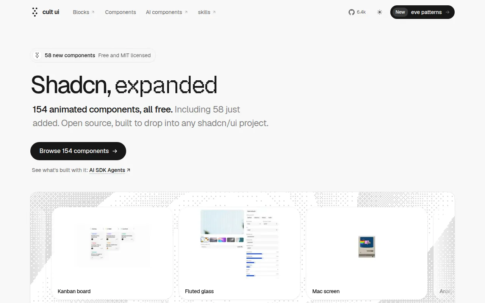</a><br>
<b><a href="https://www.cult-ui.com">Cult UI</a></b><br>
Animated components, blocks and templates for shadcn/ui, with a paid Pro tier.<br>
<sub>MIT · Free tier, paid tier alongside · <a href="https://github.com/nolly-studio/cult-ui">Repository</a></sub>
</td>
<td width="50%" valign="top">
<a href="https://dotui.org">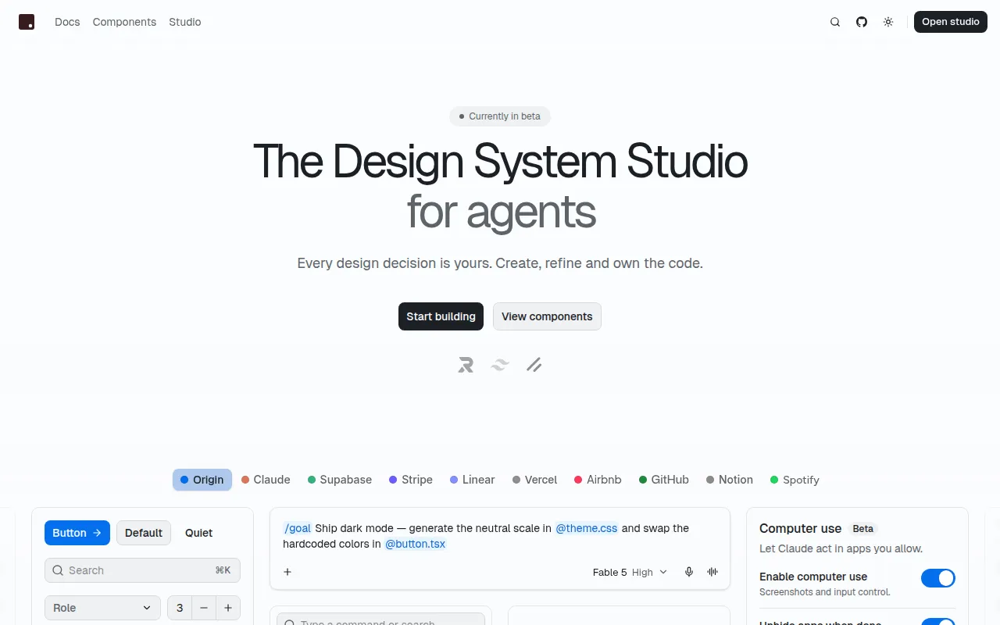</a><br>
<b><a href="https://dotui.org">Dot UI</a></b><br>
Design system studio on React Aria and Tailwind CSS that exports through the shadcn CLI.<br>
<sub>MIT · Free · <a href="https://github.com/mehdibha/dotUI">Repository</a></sub>
</td>
</tr>
<tr>
<td width="50%" valign="top">
<a href="https://enhanced-button.vercel.app">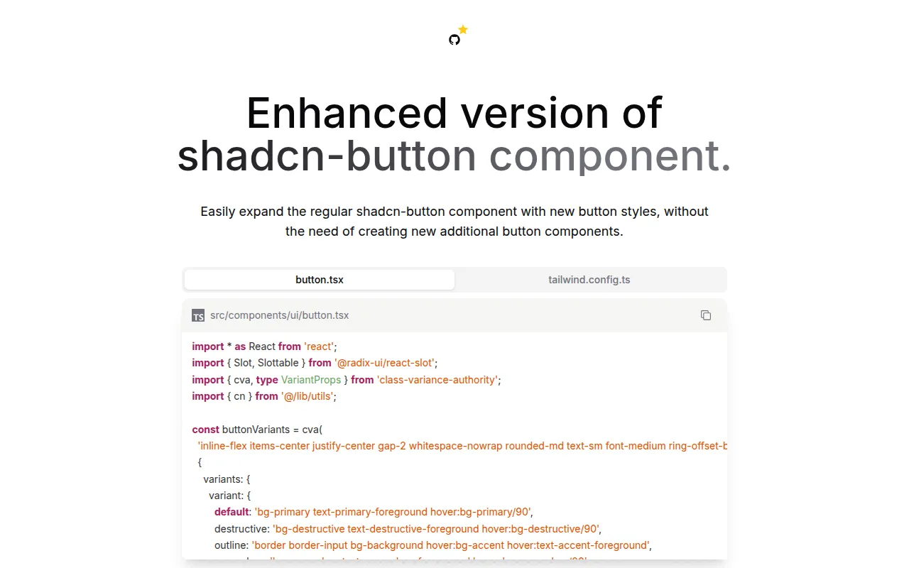</a><br>
<b><a href="https://enhanced-button.vercel.app">Enhanced Button</a></b><br>
An extended version of the shadcn/ui Button component.<br>
<sub>MIT · Free · <a href="https://github.com/jakobhoeg/enhanced-button">Repository</a></sub>
</td>
<td width="50%" valign="top">
<a href="https://www.fancycomponents.dev">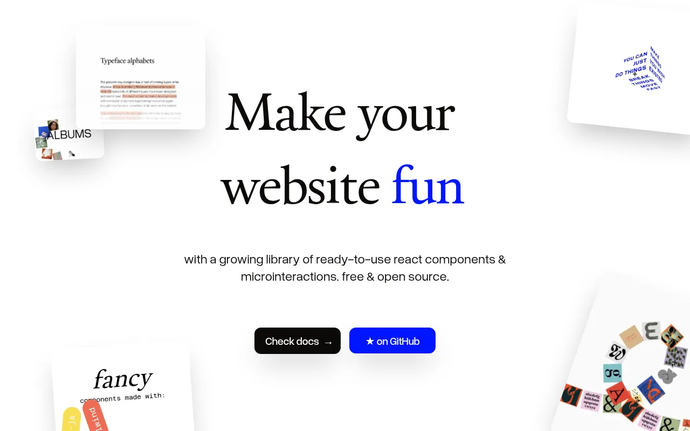</a><br>
<b><a href="https://www.fancycomponents.dev">Fancy Components</a></b><br>
Playful animated React components, installable through the shadcn CLI.<br>
<sub>MIT · Free · <a href="https://github.com/danielpetho/fancy">Repository</a></sub>
</td>
</tr>
<tr>
<td width="50%" valign="top">
<a href="https://www.jollyui.dev">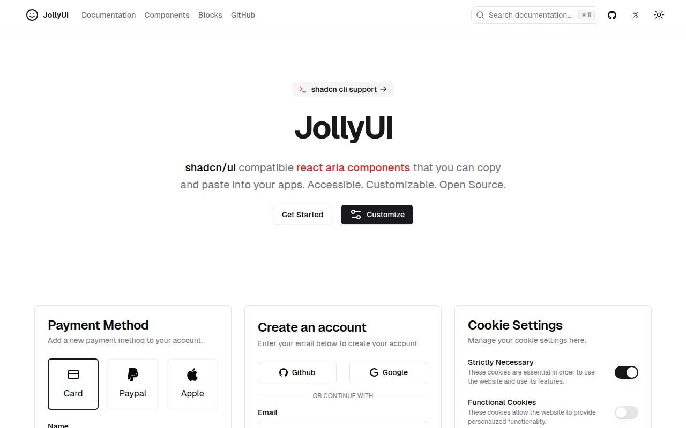</a><br>
<b><a href="https://www.jollyui.dev">JollyUI</a></b><br>
shadcn/ui-style components built on React Aria.<br>
<sub>MIT · Free · <a href="https://github.com/jolbol1/jolly-ui">Repository</a></sub>
</td>
<td width="50%" valign="top">
<a href="https://www.kibo-ui.com">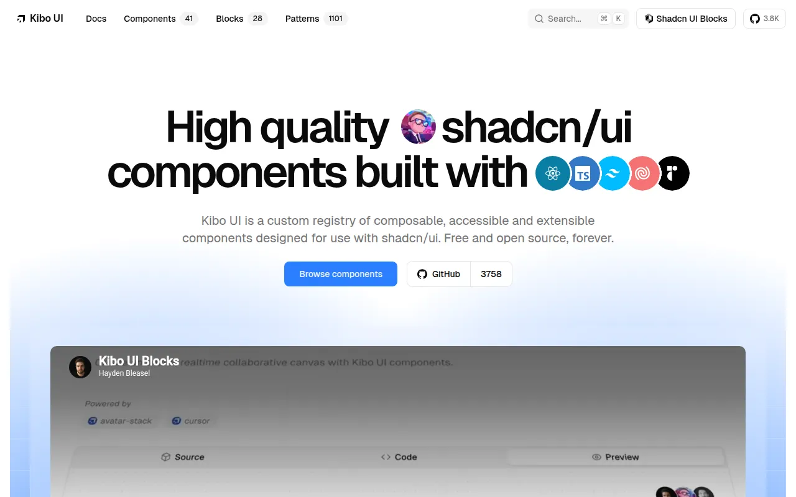</a><br>
<b><a href="https://www.kibo-ui.com">Kibo UI</a></b><br>
Components, blocks and hooks distributed through a shadcn registry.<br>
<sub>MIT · Free · <a href="https://github.com/shadcnblocks/kibo">Repository</a></sub>
</td>
</tr>
<tr>
<td width="50%" valign="top">
<a href="https://kokonutui.com">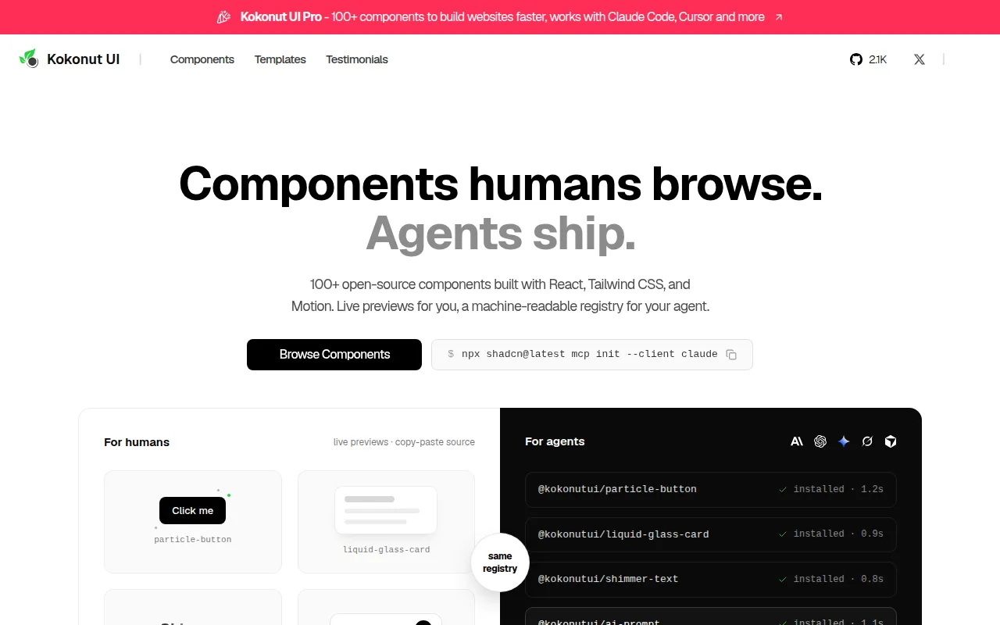</a><br>
<b><a href="https://kokonutui.com">Kokonut UI</a></b><br>
Components built with Tailwind CSS, shadcn/ui and Motion, with a paid Pro tier.<br>
<sub>MIT · Free tier, paid tier alongside · <a href="https://github.com/kokonut-labs/kokonutui">Repository</a></sub>
</td>
<td width="50%" valign="top">
<a href="https://mynaui.com">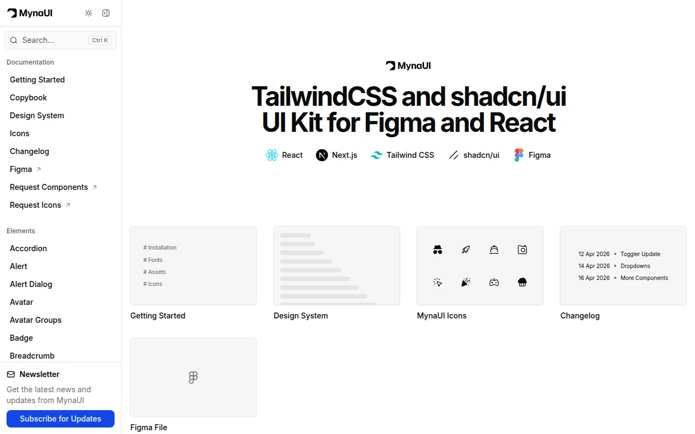</a><br>
<b><a href="https://mynaui.com">Myna UI</a></b><br>
shadcn/ui-compatible components with a matching Figma kit.<br>
<sub>No license found · Free · <a href="https://github.com/praveenjuge/mynaui">Repository</a></sub>
<br><sub>No license found in the repository or on the site; ask the author before reusing code.</sub>
</td>
</tr>
<tr>
<td width="50%" valign="top">
<a href="https://coss.com/origin">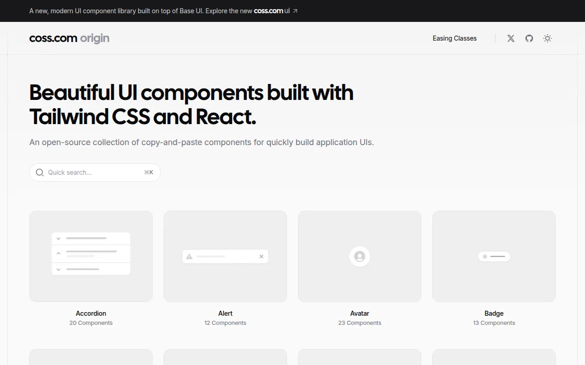</a><br>
<b><a href="https://coss.com/origin">Origin UI</a></b><br>
Radix-based components in the shadcn/ui style, installable from a shadcn registry.<br>
<sub>MIT · Free · <a href="https://github.com/cosscom/coss">Repository</a></sub>
<br><sub>Kept available by coss.com after the acquisition; originui.com now redirects to coss.com/ui. MIT applies to apps/origin, while the rest of the coss repository is AGPL-3.0.</sub>
</td>
<td width="50%" valign="top">
<a href="https://reui.io">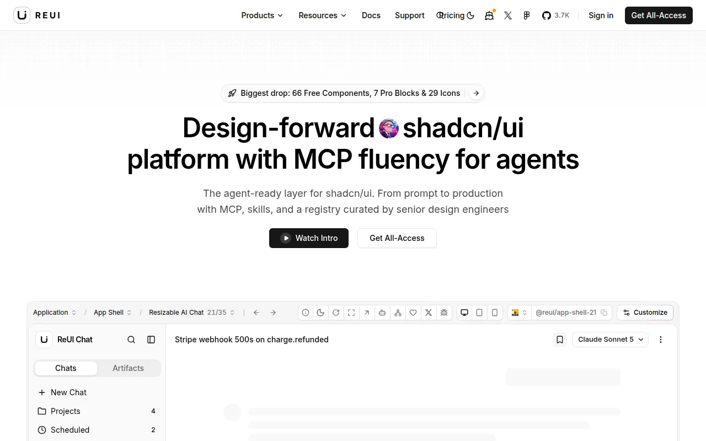</a><br>
<b><a href="https://reui.io">ReUI</a></b><br>
shadcn/ui components and patterns, with paid Pro blocks.<br>
<sub>MIT · Free tier, paid tier alongside · <a href="https://github.com/keenthemes/reui">Repository</a></sub>
</td>
</tr>
<tr>
<td width="50%" valign="top">
<a href="https://github.com/jakobhoeg/shadcn-chat">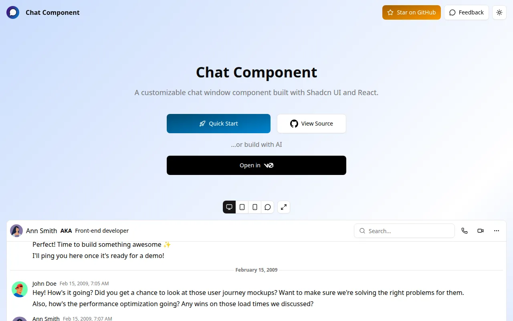</a><br>
<b><a href="https://github.com/jakobhoeg/shadcn-chat">shadcn-chat</a></b><br>
CLI that adds chat components to a shadcn/ui project.<br>
<sub>MIT · Free · <a href="https://shadcn-chat.vercel.app">Demo</a></sub>
</td>
<td width="50%" valign="top">
<a href="https://shadcnui-expansions.typeart.cc">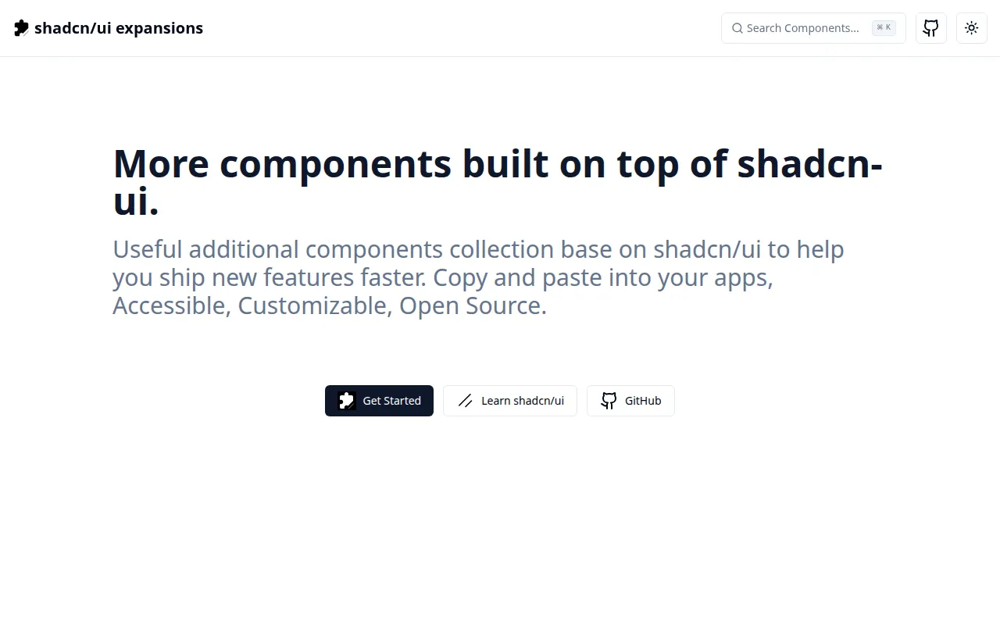</a><br>
<b><a href="https://shadcnui-expansions.typeart.cc">shadcn/ui expansions</a></b><br>
Extra components built on top of shadcn/ui.<br>
<sub>MIT · Free · <a href="https://github.com/hsuanyi-chou/shadcn-ui-expansions">Repository</a></sub>
</td>
</tr>
<tr>
<td width="50%" valign="top">
<a href="https://skiper-ui.com">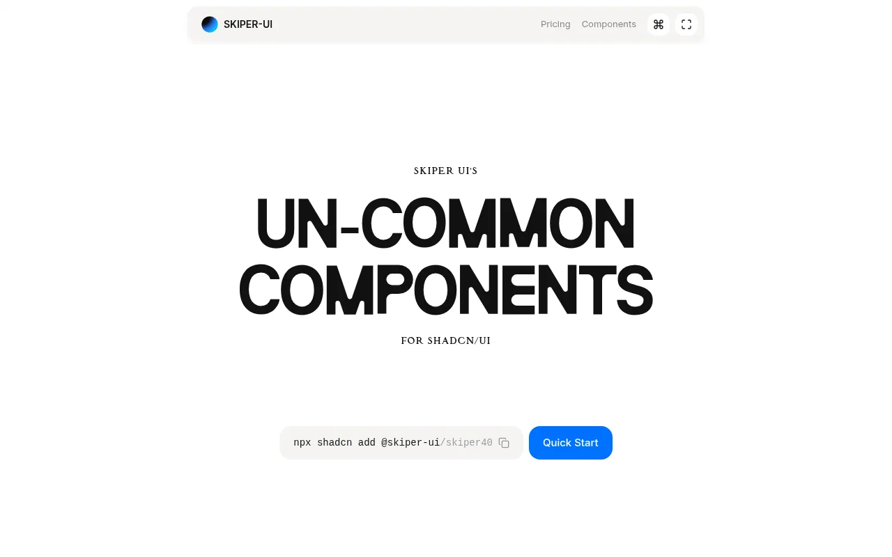</a><br>
<b><a href="https://skiper-ui.com">Skiper UI</a></b><br>
Uncommon components for shadcn/ui, with a paid Pro tier.<br>
<sub>No license found · Free tier, paid tier alongside</sub>
<br><sub>The terms of service reserve all rights and allow personal use only; read them before reusing code.</sub>
</td>
<td width="50%" valign="top">
<a href="https://www.ui-layouts.com">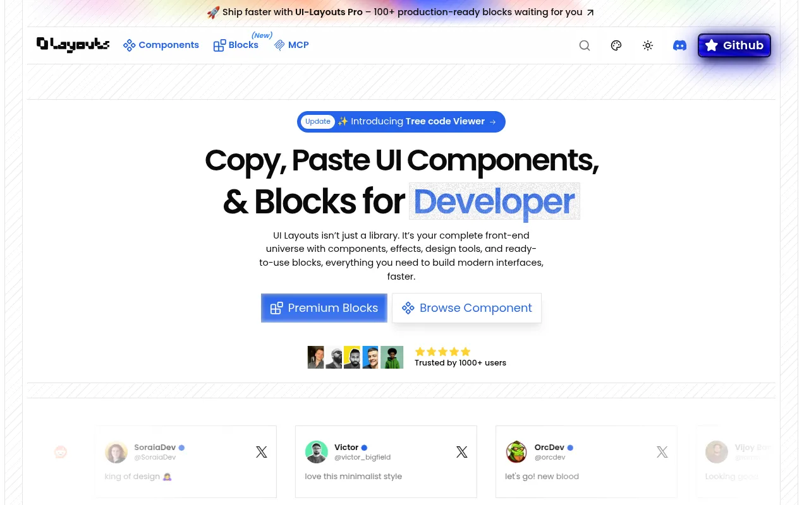</a><br>
<b><a href="https://www.ui-layouts.com">UI Layouts</a></b><br>
React and Tailwind CSS components, effects and blocks served from a shadcn registry. Paid Pro blocks alongside.<br>
<sub>MIT · Free tier, paid tier alongside · <a href="https://github.com/ui-layouts/uilayouts">Repository</a></sub>
</td>
</tr>
</table>

### Blocks

Ready-made sections such as hero, pricing, footer and auth.

<table>
<tr>
<td width="50%" valign="top">
<a href="https://shadcnspace.com/components">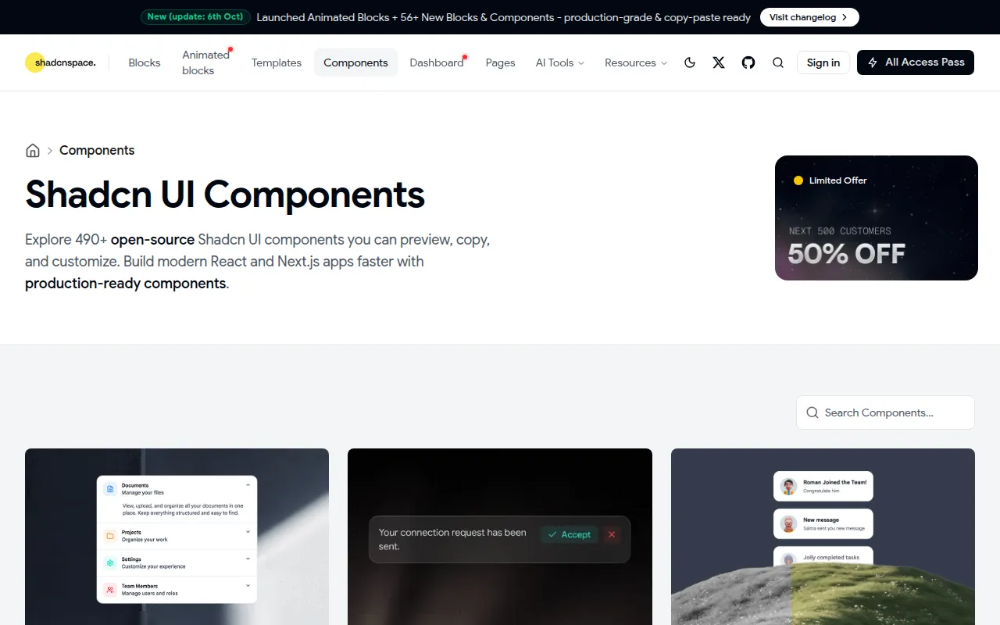</a><br>
<b><a href="https://shadcnspace.com/components">Shadcn Space</a></b><br>
Open-source shadcn/ui blocks, components and templates on Radix UI and Base UI, with a paid tier.<br>
<sub>MIT · Free tier, paid tier alongside · <a href="https://github.com/shadcnspace/shadcnspace">Repository</a></sub>
</td>
<td width="50%" valign="top">
<a href="https://shadcnstudio.com/components">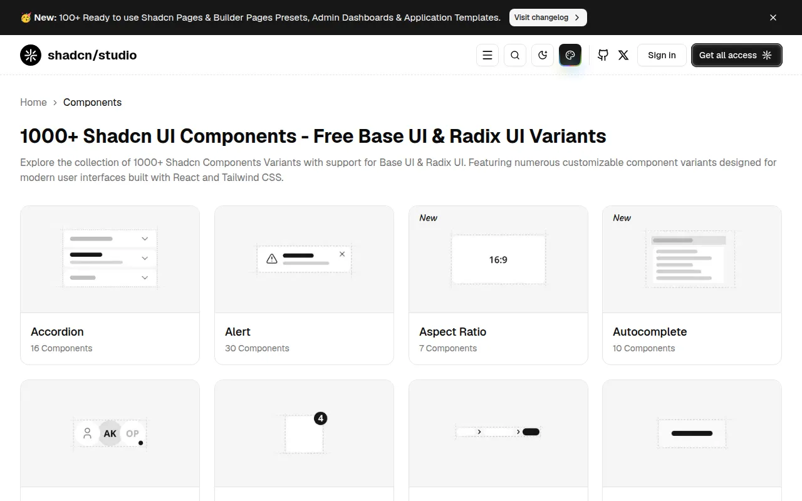</a><br>
<b><a href="https://shadcnstudio.com/components">shadcn/studio</a></b><br>
Copy-and-paste shadcn/ui components, blocks and templates, with a paid tier.<br>
<sub>MIT · Free tier, paid tier alongside · <a href="https://github.com/shadcnstudio/shadcn-studio">Repository</a></sub>
</td>
</tr>
<tr>
<td width="50%" valign="top">
<a href="https://ui.shadcn.com/blocks">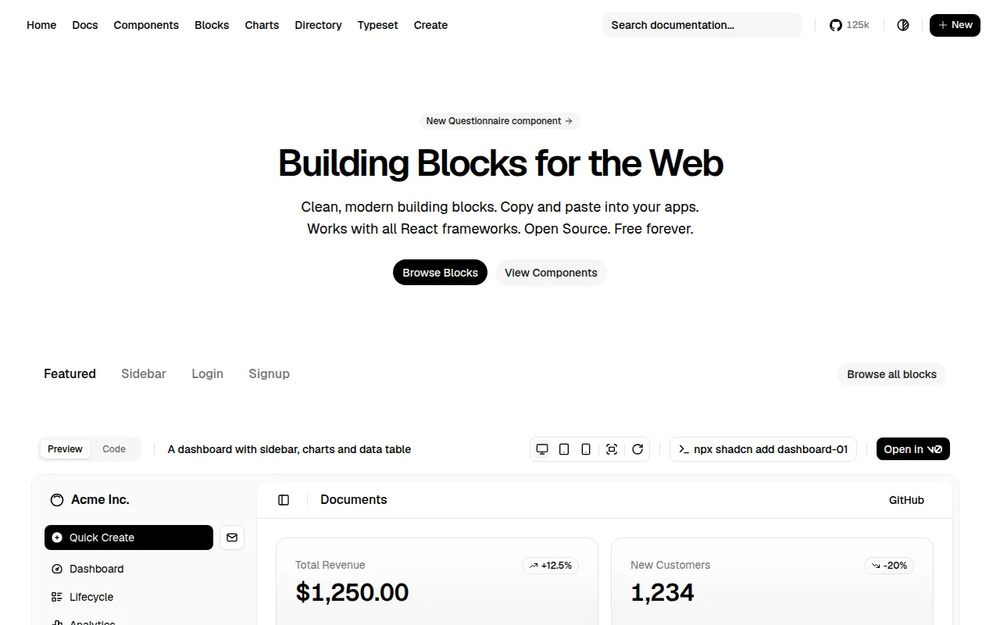</a><br>
<b><a href="https://ui.shadcn.com/blocks">shadcn/ui Blocks</a></b><br>
Official blocks for dashboards, login, checkout and settings pages.<br>
<sub>MIT · Free · <a href="https://github.com/shadcn-ui/ui">Repository</a></sub>
</td>
<td width="50%" valign="top">
<a href="https://www.shadcnblocks.com/blocks/free">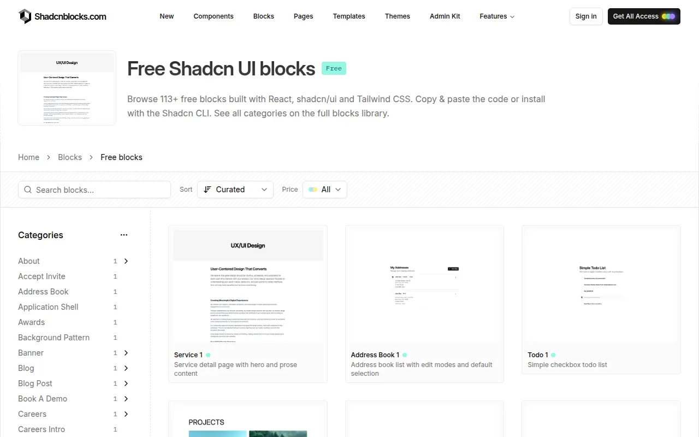</a><br>
<b><a href="https://www.shadcnblocks.com/blocks/free">Shadcnblocks</a></b><br>
The free part of a block library for shadcn/ui; the rest is paid.<br>
<sub>MIT + Commons Clause · Free tier, paid tier alongside · <a href="https://github.com/shadcnblocks/shadcn-ui-blocks">Repository</a></sub>
</td>
</tr>
<tr>
<td width="50%" valign="top">
<a href="https://shadcncraft.com/free">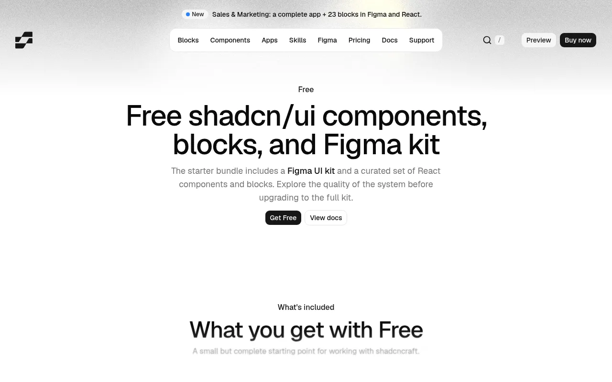</a><br>
<b><a href="https://shadcncraft.com/free">shadcncraft</a></b><br>
Free shadcn/ui kit with a Figma file, blocks and React code; the full kit is paid.<br>
<sub>Apache-2.0 · Free tier, paid tier alongside · <a href="https://github.com/shadcncraft/shadcncraft-free">Repository</a></sub>
</td>
<td width="50%"></td>
</tr>
</table>

### Animation

Animated components.

<table>
<tr>
<td width="50%" valign="top">
<a href="https://ui.aceternity.com">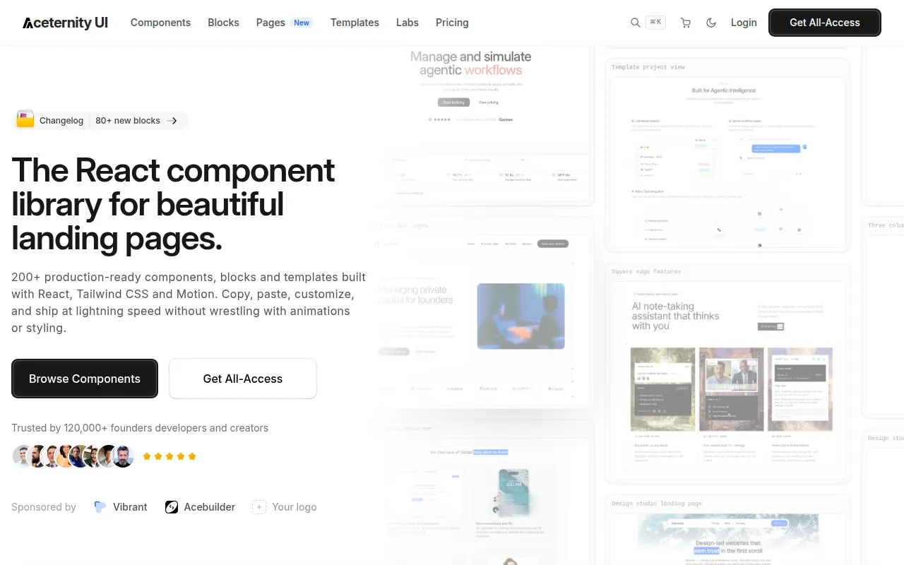</a><br>
<b><a href="https://ui.aceternity.com">Aceternity UI</a></b><br>
Animated components, 3D effects and hero sections.<br>
<sub>No license found · Free tier, paid tier alongside</sub>
<br><sub>The licence page covers the Pro tier; no license found for the free components.</sub>
</td>
<td width="50%" valign="top">
<a href="https://animate-ui.com">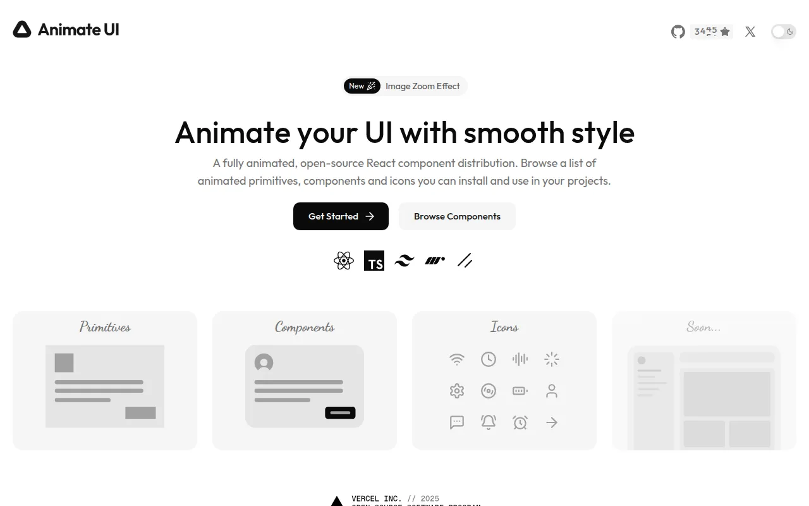</a><br>
<b><a href="https://animate-ui.com">Animate UI</a></b><br>
Animated components distributed through the shadcn CLI.<br>
<sub>MIT + Commons Clause · Free · <a href="https://github.com/imskyleen/animate-ui">Repository</a></sub>
</td>
</tr>
<tr>
<td width="50%" valign="top">
<a href="https://magicui.design">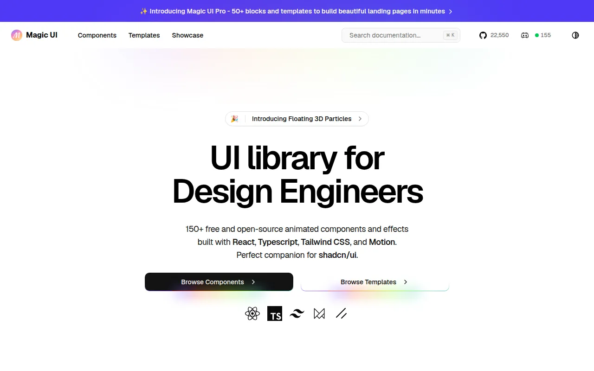</a><br>
<b><a href="https://magicui.design">Magic UI</a></b><br>
Animated landing page components. Open-source core plus a paid Pro tier.<br>
<sub>MIT · Free tier, paid tier alongside · <a href="https://github.com/magicuidesign/magicui">Repository</a></sub>
</td>
<td width="50%" valign="top">
<a href="https://motion-primitives.com">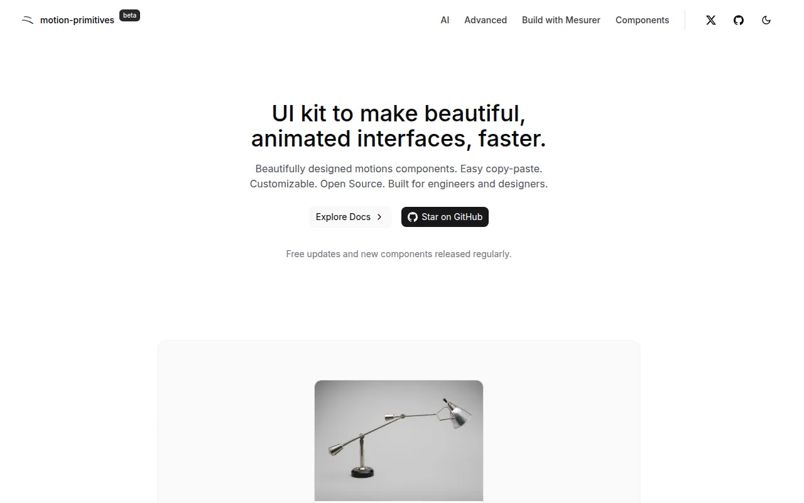</a><br>
<b><a href="https://motion-primitives.com">Motion Primitives</a></b><br>
Animated UI kit for React and Tailwind CSS with a shadcn registry. Paid tier alongside.<br>
<sub>MIT · Free tier, paid tier alongside · <a href="https://github.com/ibelick/motion-primitives">Repository</a></sub>
</td>
</tr>
<tr>
<td width="50%" valign="top">
<a href="https://reactbits.dev">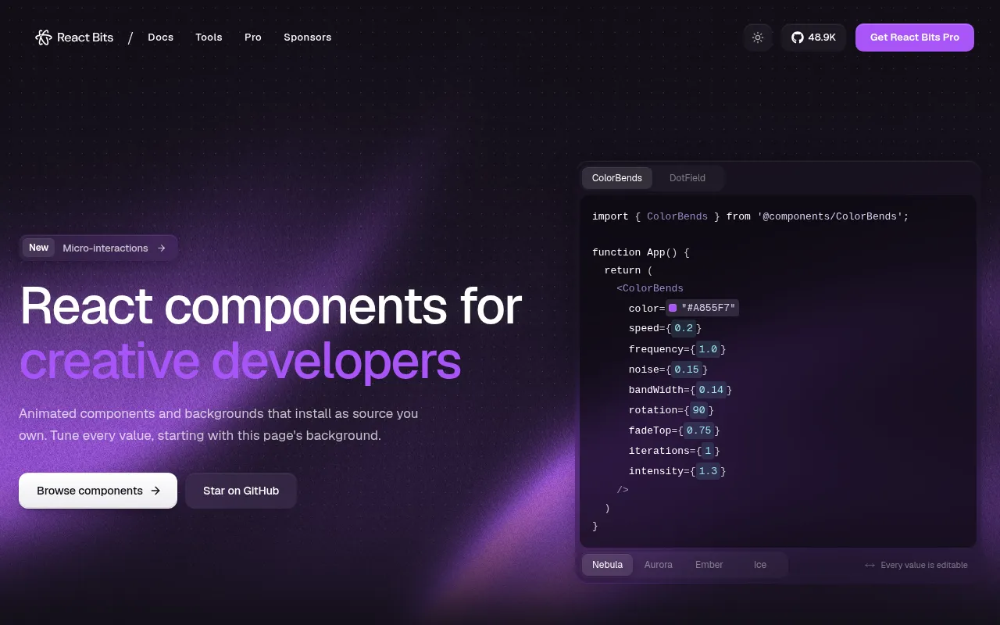</a><br>
<b><a href="https://reactbits.dev">React Bits</a></b><br>
Animated text, backgrounds and interactive components, with a paid Pro tier.<br>
<sub>MIT + Commons Clause · Free tier, paid tier alongside · <a href="https://github.com/DavidHDev/react-bits">Repository</a></sub>
</td>
<td width="50%"></td>
</tr>
</table>

### Dashboards

Admin panels and dashboard starters.

<table>
<tr>
<td width="50%" valign="top">
<a href="https://github.com/horizon-ui/shadcn-nextjs-boilerplate">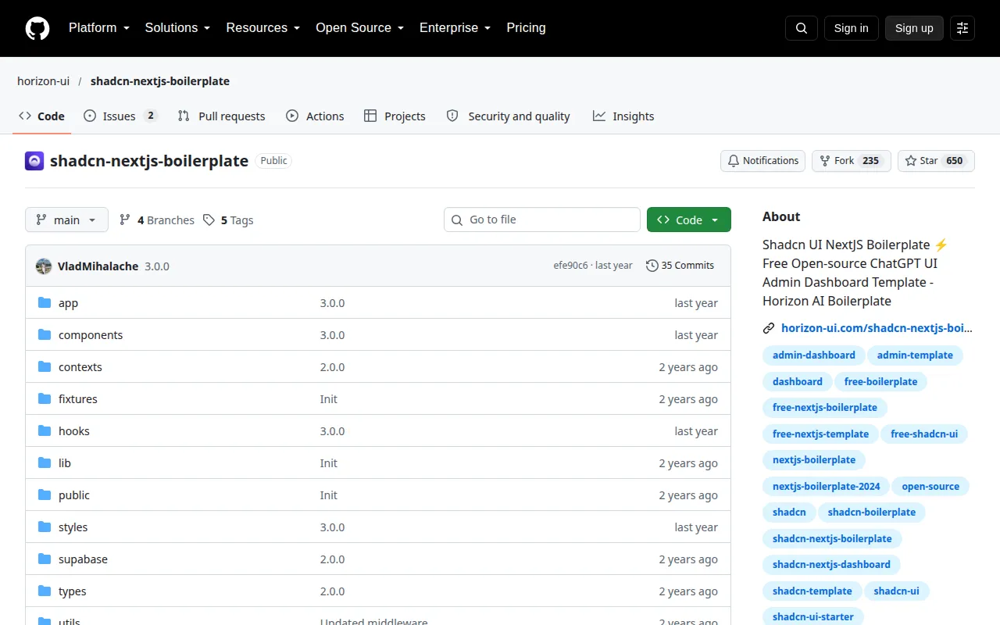</a><br>
<b><a href="https://github.com/horizon-ui/shadcn-nextjs-boilerplate">Horizon AI Boilerplate</a></b><br>
Next.js and shadcn/ui boilerplate with an AI chat admin dashboard; a Pro version is paid.<br>
<sub>MIT · Free tier, paid tier alongside</sub>
<br><sub>horizon-ui.com showed a paused deployment on 2026-10-11; the repository is still available.</sub>
</td>
<td width="50%" valign="top">
<a href="https://github.com/Kiranism/next-shadcn-dashboard-starter">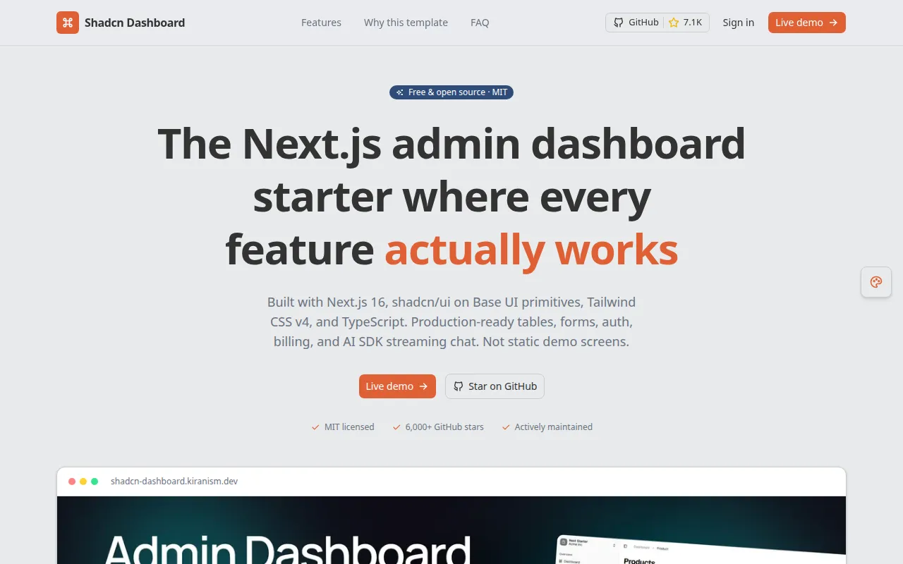</a><br>
<b><a href="https://github.com/Kiranism/next-shadcn-dashboard-starter">Next Shadcn Dashboard Starter</a></b><br>
Admin dashboard starter with auth, tables and forms.<br>
<sub>MIT · Free · <a href="https://shadcn-dashboard.kiranism.dev">Demo</a></sub>
</td>
</tr>
<tr>
<td width="50%" valign="top">
<a href="https://github.com/satnaing/shadcn-admin">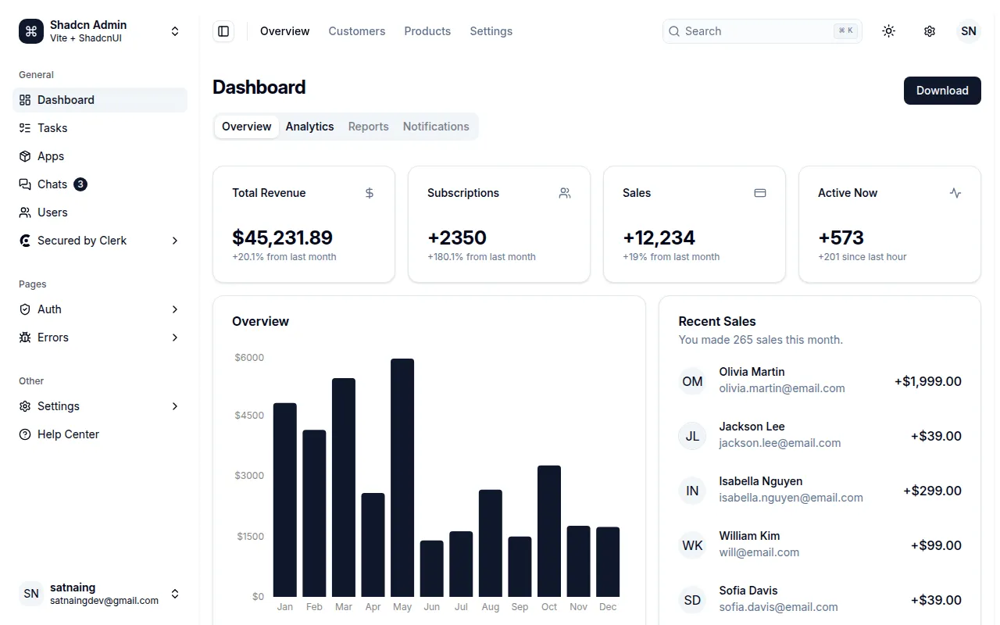</a><br>
<b><a href="https://github.com/satnaing/shadcn-admin">Shadcn Admin</a></b><br>
Admin dashboard built with shadcn/ui and Vite.<br>
<sub>MIT · Free · <a href="https://shadcn-admin.netlify.app">Demo</a></sub>
</td>
<td width="50%" valign="top">
<a href="https://shadcnuikit.com">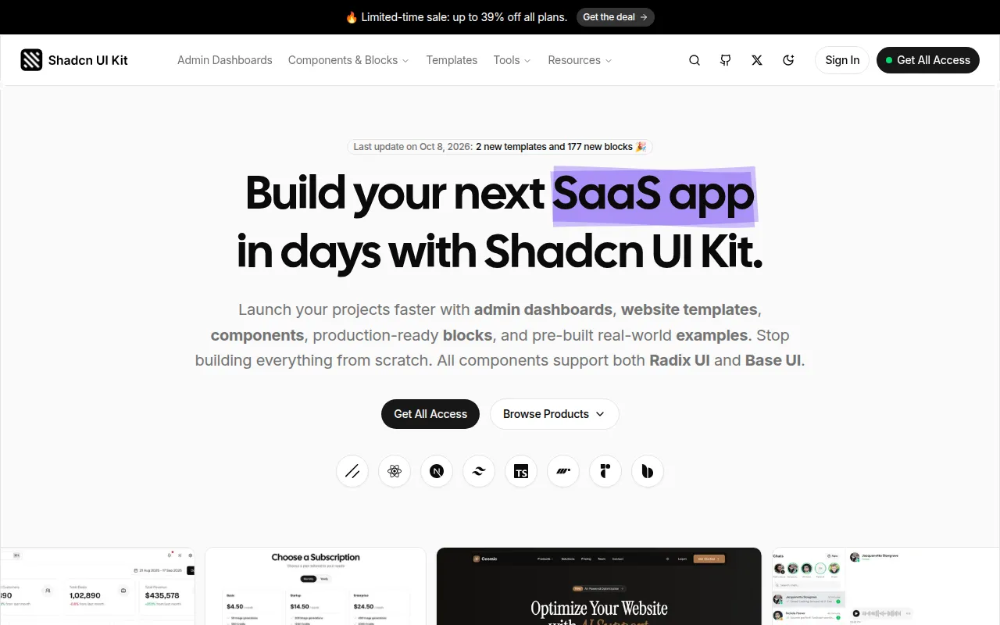</a><br>
<b><a href="https://shadcnuikit.com">Shadcn UI Kit</a></b><br>
Admin dashboards, website templates and blocks, with a paid tier.<br>
<sub>MIT · Free tier, paid tier alongside · <a href="https://github.com/bundui/shadcn-ui-kit">Repository</a></sub>
</td>
</tr>
<tr>
<td width="50%" valign="top">
<a href="https://shadcndashboard.dev">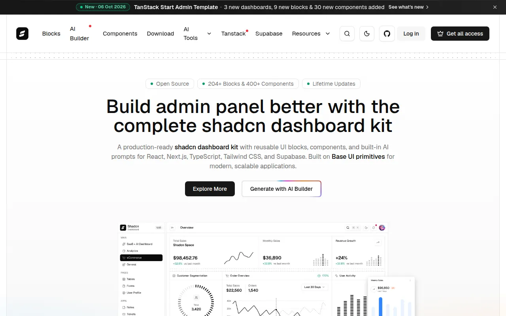</a><br>
<b><a href="https://shadcndashboard.dev">shadcndashboard.dev</a></b><br>
Admin dashboard built with React, Vite and shadcn/ui. The site also sells paid blocks and kits.<br>
<sub>MIT · Free tier, paid tier alongside · <a href="https://github.com/shadcndashboard/shadcndashboard">Repository</a></sub>
</td>
<td width="50%"></td>
</tr>
</table>

### Templates

Full sites, landing pages and app starters.

<table>
<tr>
<td width="50%" valign="top">
<a href="https://github.com/ixartz/SaaS-Boilerplate">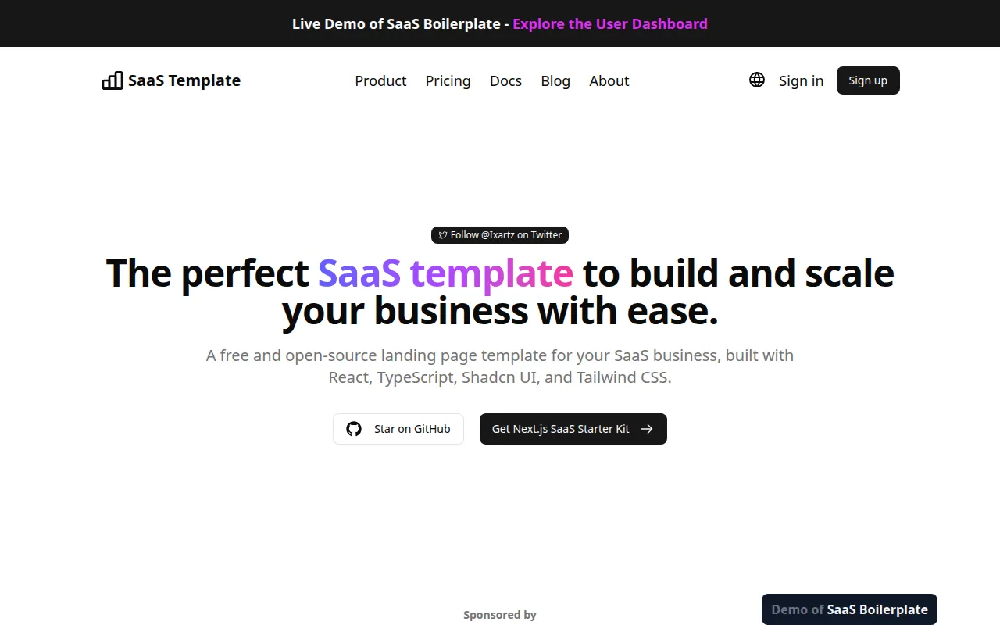</a><br>
<b><a href="https://github.com/ixartz/SaaS-Boilerplate">SaaS Boilerplate</a></b><br>
SaaS starter with shadcn/ui and authentication. A Pro version is paid.<br>
<sub>MIT · Free tier, paid tier alongside · <a href="https://react-saas.com">Demo</a></sub>
</td>
<td width="50%" valign="top">
<a href="https://github.com/vercel/chatbot">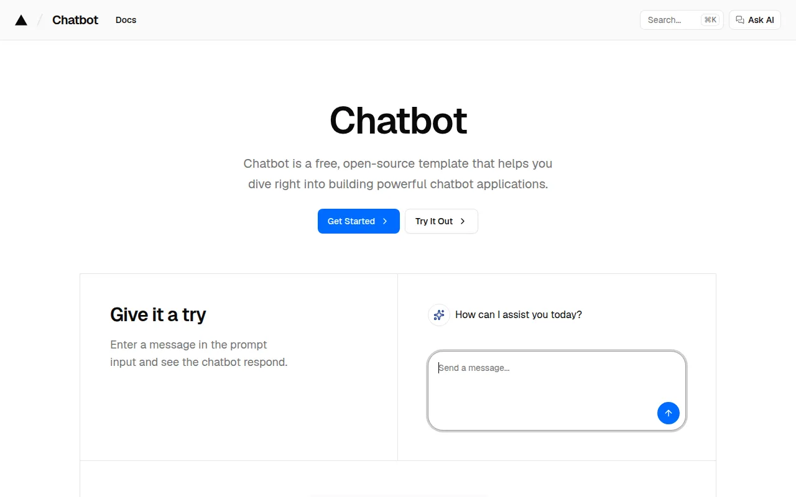</a><br>
<b><a href="https://github.com/vercel/chatbot">Vercel Chatbot</a></b><br>
Next.js AI chatbot template from Vercel, built with shadcn/ui.<br>
<sub>Apache-2.0 · Free · <a href="https://chatbot.ai-sdk.dev">Demo</a></sub>
<br><sub>Formerly Next.js AI Chatbot.</sub>
</td>
</tr>
</table>

### Themes

Color themes, theme generators and design tokens.

<table>
<tr>
<td width="50%" valign="top">
<a href="https://shadcnstudio.com/theme-generator">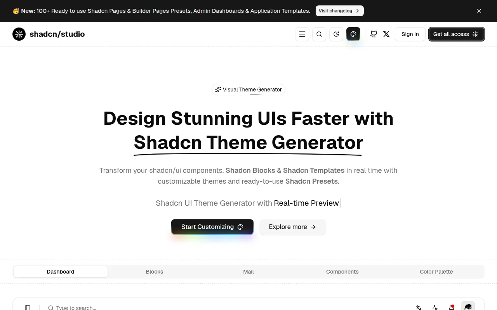</a><br>
<b><a href="https://shadcnstudio.com/theme-generator">shadcn/studio Theme Generator</a></b><br>
Theme generator for shadcn/ui covering colors, fonts and presets for light and dark mode.<br>
<sub>MIT · Free tier, paid tier alongside · <a href="https://github.com/shadcnstudio/shadcn-studio">Repository</a></sub>
</td>
<td width="50%" valign="top">
<a href="https://ui.shadcn.com/create">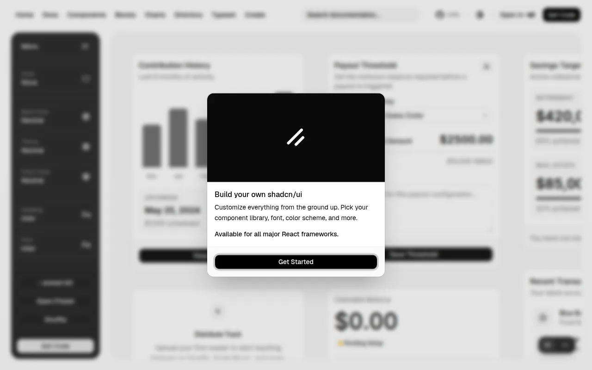</a><br>
<b><a href="https://ui.shadcn.com/create">shadcn/ui Create</a></b><br>
Official builder for a custom shadcn/ui setup, theme included.<br>
<sub>MIT · Free · <a href="https://github.com/shadcn-ui/ui">Repository</a></sub>
<br><sub>ui.shadcn.com/themes now redirects here.</sub>
</td>
</tr>
<tr>
<td width="50%" valign="top">
<a href="https://tweakcn.com">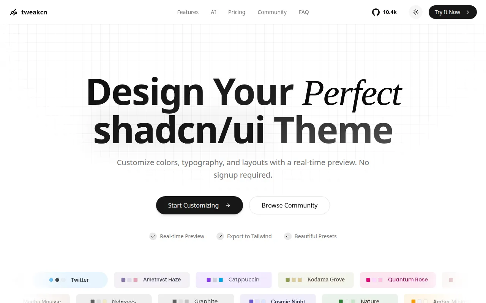</a><br>
<b><a href="https://tweakcn.com">tweakcn</a></b><br>
Visual theme editor for shadcn/ui with presets and CSS export.<br>
<sub>Apache-2.0 · Free · <a href="https://github.com/jnsahaj/tweakcn">Repository</a></sub>
</td>
<td width="50%" valign="top">
<a href="https://ui.jln.dev">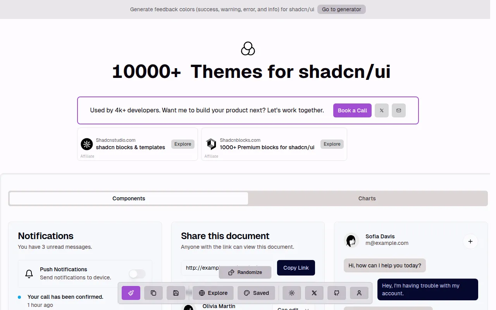</a><br>
<b><a href="https://ui.jln.dev">ui.jln.dev</a></b><br>
Color palette and theme generator for shadcn/ui with live preview.<br>
<sub>MIT · Free · <a href="https://github.com/jln13x/ui.jln.dev">Repository</a></sub>
</td>
</tr>
</table>

### Extensions

Add-ons, editors, form builders and CLI tools.

<table>
<tr>
<td width="50%" valign="top">
<a href="https://github.com/vantezzen/autoform">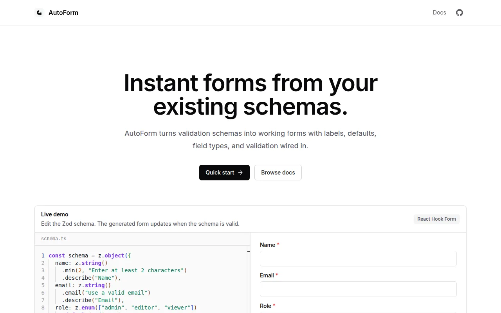</a><br>
<b><a href="https://github.com/vantezzen/autoform">AutoForm</a></b><br>
Renders forms from an existing data schema, such as Zod.<br>
<sub>MIT · Free · <a href="https://autoform.vantezzen.io">Demo</a></sub>
</td>
<td width="50%" valign="top">
<a href="https://platejs.org">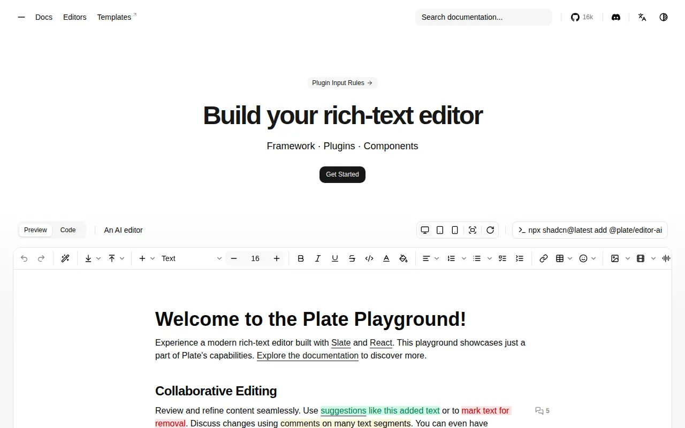</a><br>
<b><a href="https://platejs.org">Plate</a></b><br>
Rich text editor framework with components built on shadcn/ui. Paid templates alongside.<br>
<sub>MIT · Free tier, paid tier alongside · <a href="https://github.com/udecode/plate">Repository</a></sub>
</td>
</tr>
<tr>
<td width="50%" valign="top">
<b><a href="https://www.shadcn-form.com">shadcn Form Builder</a></b><br>
Visual form builder that generates shadcn/ui form code.<br>
<sub>MIT · Free · <a href="https://github.com/hasanharman/form-builder">Repository</a></sub>
<br><sub>The site's bot protection stops automated screenshots, so this entry has none.</sub>
</td>
<td width="50%" valign="top">
<a href="https://github.com/BelkacemYerfa/shadcn-extension">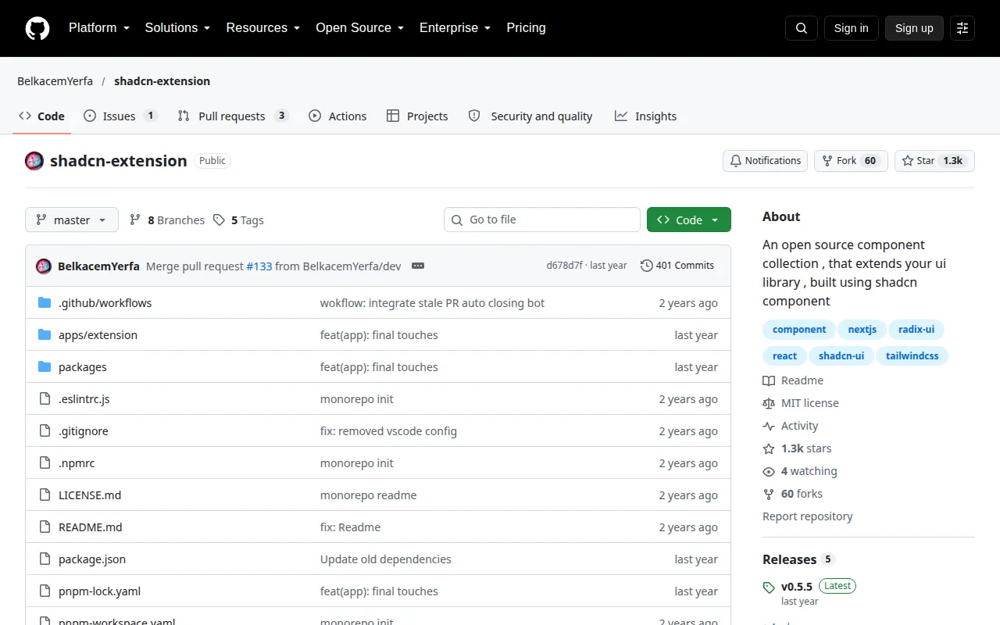</a><br>
<b><a href="https://github.com/BelkacemYerfa/shadcn-extension">shadcn-extension</a></b><br>
Extra components such as multi-select, tag input and data table.<br>
<sub>MIT · Free</sub>
<br><sub>shadcn-extension.com no longer resolves.</sub>
</td>
</tr>
<tr>
<td width="50%" valign="top">
<a href="https://shadcnui-addon.vercel.app">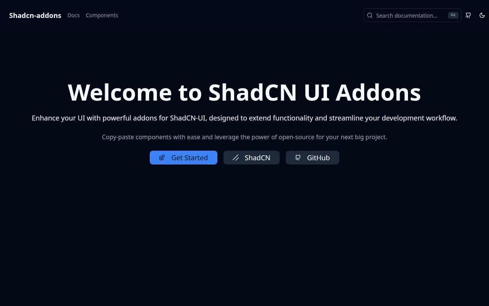</a><br>
<b><a href="https://shadcnui-addon.vercel.app">shadcnui-addon</a></b><br>
Add-on components that extend shadcn/ui.<br>
<sub>No license found · Free · <a href="https://github.com/AmruthLP12/shadcnui-addon">Repository</a></sub>
<br><sub>No license in the repository; ask the author before reusing code.</sub>
</td>
<td width="50%" valign="top">
<a href="https://tablecn.com">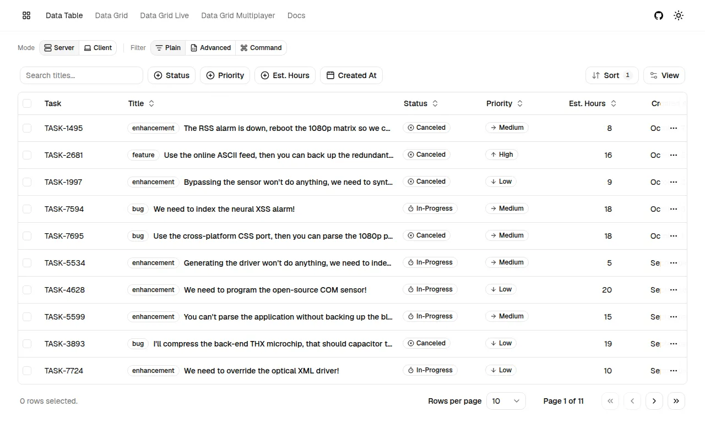</a><br>
<b><a href="https://tablecn.com">tablecn</a></b><br>
Data table and data grid components built with shadcn/ui.<br>
<sub>MIT · Free · <a href="https://github.com/sadmann7/tablecn">Repository</a></sub>
</td>
</tr>
</table>

### Charts

Chart components.

<table>
<tr>
<td width="50%" valign="top">
<a href="https://ui.shadcn.com/charts">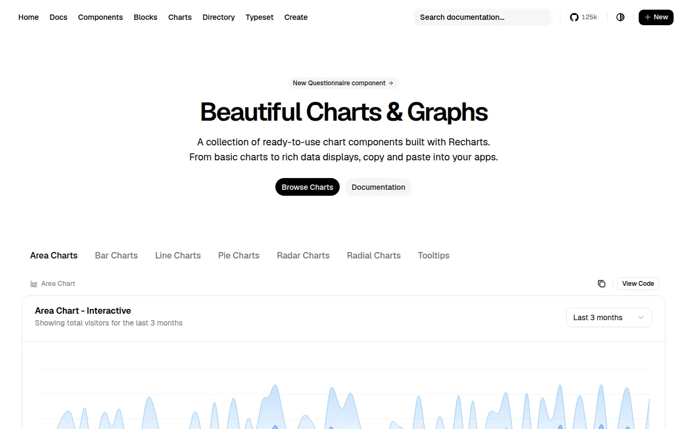</a><br>
<b><a href="https://ui.shadcn.com/charts">shadcn/ui Charts</a></b><br>
Official chart components built on Recharts.<br>
<sub>MIT · Free · <a href="https://github.com/shadcn-ui/ui">Repository</a></sub>
</td>
<td width="50%"></td>
</tr>
</table>

### Ports

shadcn/ui for other frameworks, such as Vue and Solid.

<table>
<tr>
<td width="50%" valign="top">
<a href="https://www.shadcn-vue.com">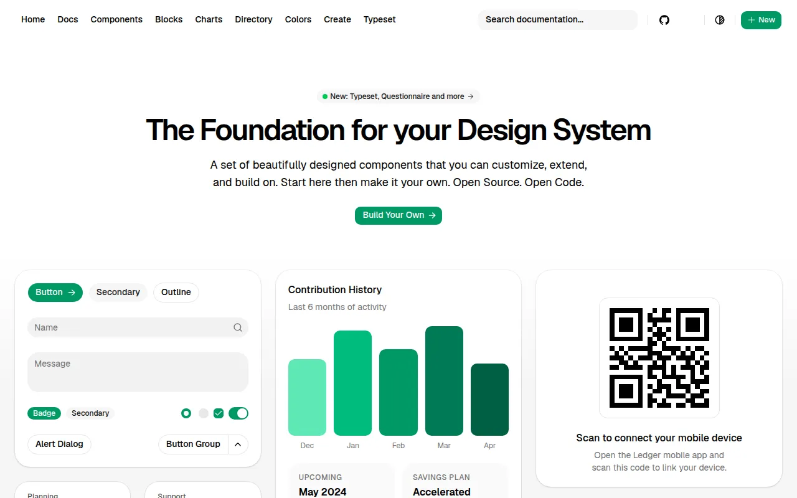</a><br>
<b><a href="https://www.shadcn-vue.com">shadcn-vue</a></b><br>
Port of shadcn/ui to Vue.<br>
<sub>MIT · Free · <a href="https://github.com/unovue/shadcn-vue">Repository</a></sub>
</td>
<td width="50%" valign="top">
<a href="https://www.solid-ui.com">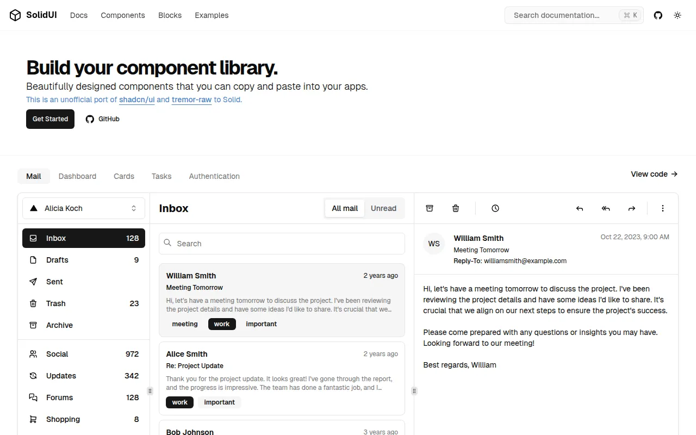</a><br>
<b><a href="https://www.solid-ui.com">Solid UI</a></b><br>
Unofficial port of shadcn/ui to SolidJS.<br>
<sub>MIT · Free · <a href="https://github.com/stefan-karger/solid-ui">Repository</a></sub>
</td>
</tr>
</table>
<!-- gallery:end -->

## What is left out

Some things turn up on every shadcn list without being extensions. They go in `excluded.yaml` with one of these reasons, so they are not added again on the next harvest:

| Reason | Meaning |
|---|---|
| `core` | shadcn/ui itself and its docs |
| `upstream` | A library shadcn/ui is built on, or a headless primitive layer, such as Radix, cmdk or Recharts |
| `not-shadcn` | Tailwind CSS or React UI that is not built on shadcn/ui |
| `showcase` | An app that uses shadcn/ui but is not meant to be reused |
| `aggregator` | A general directory; the shadcn-specific ones are in `sources.md` |

## Files

| Path | Contents |
|---|---|
| `catalog.yaml` | The index, one entry per resource |
| `categories.yaml` | The categories, in the order the index shows them |
| `excluded.yaml` | What was considered and left out, with the reason |
| `sources.md` | Lists and directories we harvest links from |
| `screenshots/<slug>.webp` | One screenshot per entry, named after its `slug` |
| `scripts/` | The screenshot and index scripts |

## Entry format

```yaml
- slug: magic-ui
  name: Magic UI
  description: Animated landing page components. Open-source core plus a paid Pro tier.
  url: https://magicui.design
  demo: ""           # a public demo page, when url points at a repository
  repo: https://github.com/magicuidesign/magicui
  category: animation
  license: MIT
  free: partial      # full | partial | unknown
  status: candidate  # candidate | verified | screenshotted
  source: manual     # a source from sources.md, or manual
  screenshot: screenshots/magic-ui.webp
  notes: ""
```

`free: partial` means a free part next to a paid tier, and `url` then points straight at the free part. `license` is the SPDX identifier where one exists, and otherwise the license as the project names it, such as `MIT + Commons Clause`. `source` names the list the entry was harvested from, or `manual` when it was added by hand. Fields that are not known yet, such as `repo` or `license`, are left out until they are.

## How an entry gets in

1. **Harvest.** Go through `sources.md` and add new links to `catalog.yaml` as `candidate`, after searching both `catalog.yaml` and `excluded.yaml` for the URL.
2. **Verify.** Open the link. Confirm that the resource extends shadcn/ui and is free, fill in `license`, `repo` and `free`, then set `verified`. When no license can be found, `notes` says so; the entry is still listed.
3. **Screenshot.** Run the screenshot script (below). It shoots `demo` when there is one and `url` otherwise, then sets `screenshot` and `screenshotted`.
4. **Publish.** Run the index script. It checks `catalog.yaml` and rewrites the index section of this readme. Candidates stay out of the index until they are verified.

## Screenshots and removal

Screenshots are taken from each project's public demo or landing page and link back to the source. The script shoots at 1280 by 800 pixels and saves WebP. Cookie banners are declined or hidden, never accepted; nothing behind a login is captured, and a page behind bot protection is left alone.

If you own a listed project and want the entry or its screenshot removed, open an issue. It will be taken down.

## Scripts

Both scripts read `catalog.yaml` and run from `scripts/`:

```bash
cd scripts
npm install
npx playwright install chromium   # only needed for screenshots
node screenshots.mjs              # entries without a screenshot; or named slugs, or --all
node gallery.mjs                  # check the catalog and rewrite the index
```

`node gallery.mjs --check` checks the catalog without touching the readme. Run it before opening a pull request.

## Contributing

Suggestions, corrections and removal requests are all welcome. See [contributing.md](contributing.md).

## License

The index itself (`catalog.yaml`, `excluded.yaml`, `sources.md`, the scripts and this readme) is dedicated to the public domain under [CC0 1.0](license). Use it for anything.

The listed projects keep their own licenses, noted per entry. Screenshots show other people's work and belong to their respective owners; the CC0 dedication does not cover them.

This project is not affiliated with shadcn/ui or its authors.
